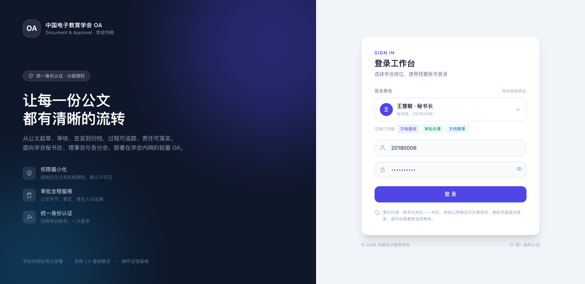
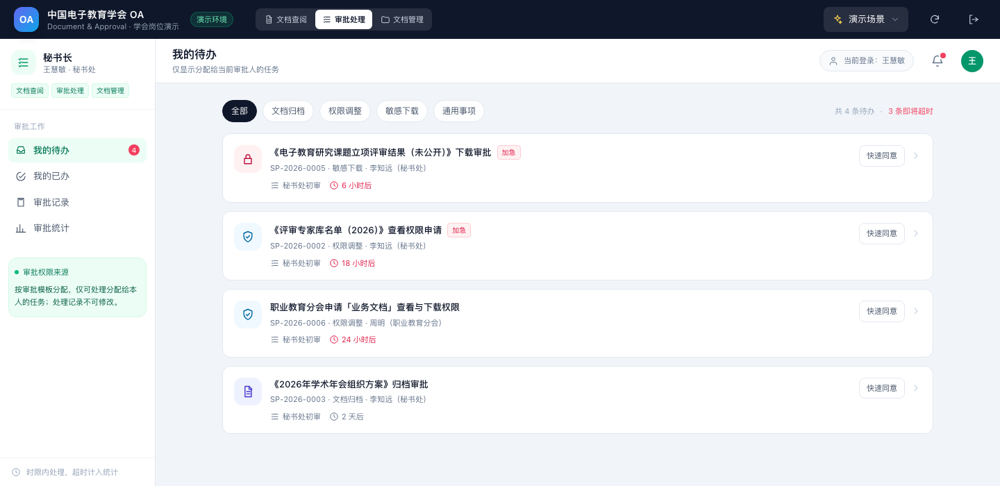

# 中国电子教育学会 · 公文与审批 OA 演示

三个**独立 Vue 3 单文件组件**，分别承载「文档查阅」「审批处理」「文档管理」三类功能面板。登录按**学会实际岗位**进行，同一岗位可拥有其中一项或多项功能权限，登录后通过顶部功能切换进入对应面板。





## 快速开始

在项目根目录启动服务（`static/` 为站点根目录）：

```bash
node webServer.js
# 或仅演示前端：
python3 -m http.server 8765 --directory static
```

访问：

- 入口（统一身份认证登录页）：`http://localhost/oa-demo/index.html`
- 直达功能视角（登录页预选代表性岗位）：`#staff`、`#approver`、`#docadmin`

> 页面通过 HTTP 访问；`file://` 方式无法 fetch `.vue` 组件。

## 登录与岗位

首次打开进入**统一身份认证登录页**，在「登录角色」中选择学会实际岗位，账号自动带入，密码已预填（演示环境可任意修改）。

| 岗位 | 姓名 | 账号 | 功能权限 |
| --- | --- | --- | --- |
| 理事长 | 孙建国 | 20120001 | 文档查阅、审批处理 |
| 副理事长 | 赵启明 | 20160001 | 文档查阅、审批处理 |
| 常务理事 | 刘洋 | 20190021 | 文档查阅、审批处理 |
| 秘书长 | 王慧敏 | 20180006 | 文档查阅、审批处理、文档管理 |
| 副秘书长 | 张倩 | 20220008 | 文档查阅、审批处理 |
| 职业教育分会联络人 | 周明 | 20210015 | 文档查阅、审批处理 |
| 档案管理员 | 陈静 | 20150012 | 文档查阅、文档管理 |
| 秘书处专员 | 李知远 | 20230001 | 文档查阅 |

登录后的行为：

- 顶部**不显示岗位信息与提示文案**，避免把登录身份暴露在公共区域；岗位与部门信息仅出现在左侧导航。
- 岗位拥有多项功能权限时，顶部提供**功能切换**（文档查阅 / 审批处理 / 文档管理）；只有一项时不显示切换控件。
- 每个功能视角只呈现对应面板的功能，侧边栏不会混入其他功能入口。
- 登录状态保存在 `sessionStorage`（岗位 + 当前功能视角）：**刷新页面保持登录**；退出登录或关闭标签页后需重新选择岗位。
- 直接访问 `#approver` 等地址时，登录页会预选代表性岗位（如 `#approver` → 秘书长），不会绕过登录。
- 跨角色走查可使用右上角「演示场景」，它会**自动切换为对应岗位身份**并打开页面/弹窗。

## 文件结构

```
static/oa-demo/
├── index.html                     # 演示壳：登录页、岗位与功能视角、演示场景
├── app.js                         # 壳应用：登录态、岗位权限、12 个跨角色演示场景
├── loader.js                      # 轻量 SFC 加载器（fetch .vue → Vue 运行时编译）
├── store.js                       # 共享 mock 数据、岗位定义与业务动作（localStorage 持久化）
├── icons.js                       # oa-icon 图标组件（线性 SVG）
├── preview-login.png              # 登录页截图
├── preview.png                    # 岗位工作台截图
└── components/
    ├── StaffPanel.vue             # 文档查阅面板（独立组件）
    ├── ApproverPanel.vue          # 审批处理面板（独立组件）
    └── DocAdminPanel.vue          # 文档管理面板（独立组件）
```

## 三个功能面板

| 组件 | 功能视角 | 覆盖能力 |
| --- | --- | --- |
| `StaffPanel.vue` | 文档查阅 | 工作台、公文与文档检索预览、水印下载、上传文档、提交归档、发起审批、撤回与催办、权限申请、到期提醒、通知 |
| `ApproverPanel.vue` | 审批处理 | 待办 / 已办、审批详情、同意、退回、驳回、转办、加签、催办、审批记录、审批单打印导出、统计 |
| `DocAdminPanel.vue` | 文档管理 | 文档库、批量归档/授权/删除、版本上传与回滚、归档/取消归档、分类管理、授权台账、到期预警、回收站、审批记录、统计 |

三个组件均以 `props.store` 接收共享数据源（必填）；登录后 `store.currentUser` 为当前岗位人员，组件依据该身份展示「我的文档 / 我的待办 / 通知」等内容。宿主可用 `OaDemo.createStore()` 创建 store（见下文「组件接入」）。

## 12 个演示场景

进入页面后点击右上角 **「演示场景」**，会**自动切换岗位身份并打开对应页面/弹窗**：

| # | 场景 | 演示身份 | 对应用例 |
| --- | --- | --- | --- |
| 1 | 上传文档并提交归档 | 李知远 · 秘书处专员 | UC-004 |
| 2 | 处理归档审批（同意 → 流转终审） | 王慧敏 · 秘书长 | UC-013 |
| 3 | 退回、驳回与加签 | 王慧敏 · 秘书长 | UC-008 / UC-014 |
| 4 | 敏感文档下载审批 | 李知远 · 秘书处专员 | UC-023 |
| 5 | 申请文档权限 | 李知远 · 秘书处专员 | UC-010 |
| 6 | 文档授权与权限台账 | 陈静 · 档案管理员 | UC-008 / UC-009 |
| 7 | 版本更新与回滚 | 陈静 · 档案管理员 | UC-006 |
| 8 | 回收站恢复与清理 | 陈静 · 档案管理员 | UC-018 |
| 9 | 批量归档与批量授权 | 陈静 · 档案管理员 | UC-019 |
| 10 | 撤回与催办 | 李知远 · 秘书处专员 | UC-014 |
| 11 | 转办与加签 | 王慧敏 · 秘书长 | UC-014 |
| 12 | 跨分会共享审批 | 陈静 · 档案管理员 | UC-030 |

### 建议演示路径（真实岗位闭环）

1. **李知远（秘书处专员）** → 我的文档 → 对《学会会费收支报告（2026上半年）》点「提交归档」→「提交审批」。
2. **王慧敏（秘书长）** → 功能切换「审批处理」→ 待办中出现该报告 → 同意 → 流程流转至副理事长。
3. **赵启明（副理事长）** → 审批处理 → 同意 → 文档归档；李知远「我的文档」中状态变为 **已归档**。
4. **李知远** → 文档中心 → 打开《电子教育研究课题立项评审结果（未公开）》→「申请下载」→ 填写用途提交。
5. **王慧敏** → 审批处理 → 同意 → 李知远在「权限申请」中看到 **24 小时 / 1 次** 下载授权，可下载带水印演示文件。
6. **王慧敏** → 顶部切到「文档管理」→ 授权台账 → 新增跨分会授权 → 提交后进入审批。
7. **周明（分会联络人）** / **张倩（副秘书长）** / **刘洋（常务理事）** / **孙建国（理事长）** → 审批处理 → 可看到分会初审、秘书处复核、会员入会审议与理事长终审的待办。
8. 演示结束可在「演示场景」底部或右上角刷新按钮 **重置数据**。

## 用例覆盖

- 已覆盖：UC-001（登录态展示）、003、004、005、006、007、008、009、010、012、013、014、015、018、019、020、021、023、030。
- 未覆盖：UC-002、011、016、017、022、024、025、026、027、028、029 —— 属于系统管理员 / 审计员 / 运维职责，不在本次三个功能面板范围内。

## 数据如何流转（store.js）

共享 mock store 是三个面板联动的关键：

```
文档查阅岗位上传 → DRAFT
提交归档          → 生成 DOC_ARCHIVE 实例（秘书处初审 → 副理事长终审），文档 SUBMITTED
审批岗位同意       → 节点通过；全部通过后文档 ACTIVE，发起人收到通知
退回 / 驳回        → 文档 RETURNED / DRAFT，发起人可修改重提或重新发起
敏感下载申请       → 生成 SENSITIVE_DOWNLOAD 实例；通过后写入 24h / 1 次临时授权
文档管理岗位授权   → 敏感 / 跨分会 / 期限 > 90 天 → 生成 PERM_GRANT 实例；否则立即生效
```

实现要点：

- 岗位与功能权限集中在 `store.js` 的 `ROLE_DEFS`，每人一个账号，`caps` 数组决定可切换的功能视角。
- 演示数据围绕学会公文与事务：章程、理事会计划、会议纪要、用印制度、课题评审、学术年会、分会方案、会费收支等。
- 数据保存在 `localStorage`（key：`oa-demo-state-v4`），刷新不丢失；重置按钮清除。
- 登录会话保存在 `sessionStorage`（key：`oa-demo-session-v1`，JSON：`{role, view}`）。
- 所有动作都会同步更新文档状态、审批实例、授权、通知与文档时间线。
- 演示下载会生成一个带水印信息的 `.txt` 文件，便于展示「下载留痕」。
- 审批单「打印 / 导出 PDF」调用浏览器打印，可用于演示打印版式。

## 组件接入说明

### 依赖

- Vue 3 全局构建（含运行时模板编译器）：`/transweb/components/ElementVueItem/vue.global.js`
- Tailwind：演示页通过 `/common/tailwindcss.js`（本地 Play CDN）加载，配置 `prefix: "tw-"`，组件内所有工具类均为 `tw-` 前缀。
- 全局图标组件 `oa-icon`：由 `icons.js` 注册（`app.component("oa-icon", OaIcon)`）。

### 单独使用

```js
import StaffPanel from "./components/StaffPanel.vue"; // 需 Vue SFC 编译环境
// 或者沿用本目录 loader：
const options = await OaDemo.load("/oa-demo/components/StaffPanel.vue");
app.component("StaffPanel", options);
app.component("oa-icon", window.OaIcon);

const store = OaDemo.createStore();
store.currentUser = store.roleByKey("specialist"); // 设置当前岗位人员
// 模板中使用：<StaffPanel :store="store" />
```

组件契约：

| 项目 | 说明 |
| --- | --- |
| props | `store`（必填）：由 `OaDemo.createStore()` 创建，或替换为真实接口适配层 |
| 当前用户 | 读取 `store.currentUser`（含 `account / name / title / deptName / caps`）；未设置时回退到默认演示人员 |
| 事件 | 无向外事件；所有交互写入 store，宿主可通过 store 状态联动 |
| 样式 | 组件内 `<style>` 仅包含少量 hover / 弹层 / 水印 / 打印样式，不与 Tailwind 工具类冲突 |
| 响应式 | 面向 1280px 及以上桌面端设计；窄屏下内容可横向滚动 |

### 替换为真实接口

`store.js` 的 `api` 对象集中了全部业务动作（`uploadDoc`、`submitArchive`、`handleTask`、`createGrant`、`requestPermission` 等）。接入后端时，只需把这些方法替换为 `/oa/...` 接口调用，并保持返回结构一致，三个组件无需修改。

## 样式说明

- 项目既有编译版 Tailwind 使用 `tw-` 前缀且缺少 `hover:` 变体，因此演示页改用本地 Play CDN（`static/common/tailwindcss.js`）+ `prefix: "tw-"`，既保持前缀约定，又能使用 hover / focus / 任意值等能力。
- 生产环境建议改为 Tailwind CLI/PostCSS 预编译（保留 `prefix: "tw-"`），移除 Play CDN。
- 遵循 `AGENTS.md`：组件样式中**未使用** `:deep()`、`::v-deep`、`>>>`、`/deep/` 深度选择器。

## 已知限制

- 纯前端演示，不连接真实数据库与统一身份认证；登录态为页面内模拟，密码校验仅用于演示。
- 岗位与权限为演示配置，生产环境应由学会组织架构、理事会名单与角色分配接口提供。
- 文档预览为版式模拟，上传不会真正解析文件；下载生成演示文本文件。
- 审批时限、统计图表使用演示数据；接入后端后由接口返回真实值。
- 附件预览、导出 PDF 为前端模拟；生产环境由服务端生成。
